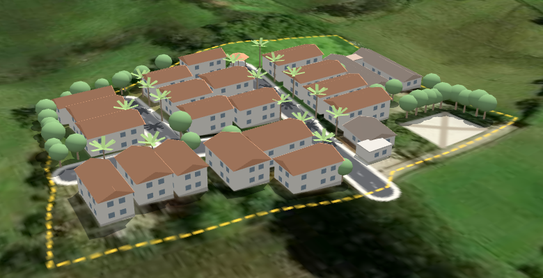
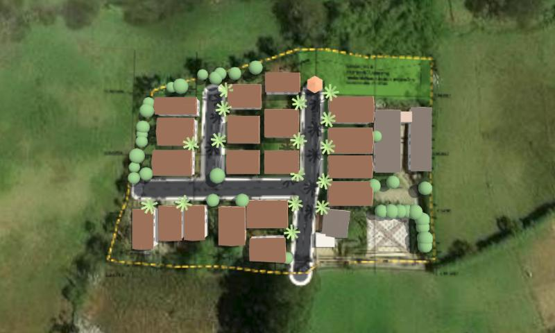
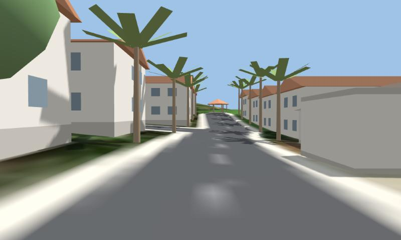
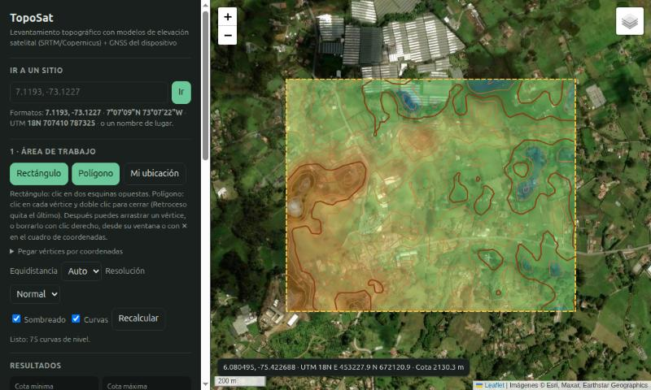

# TopoSat

Levantamiento topográfico en el navegador con modelos de elevación satelital (SRTM / Copernicus) y el GNSS del dispositivo.

[](https://lj2755.github.io/toposat/simulacion.html)

[](https://lj2755.github.io/toposat/simulacion.html)

[](https://lj2755.github.io/toposat/simulacion.html)

*Simulación 3D del Condominio Pontezuela: casas, vías, árboles y lindero sobre el terreno y la imagen satelital reales. De arriba abajo: vista aérea; vista en planta con el lindero (amarillo) y la cesión de protección ambiental (verde); y vista peatonal desde la portería subiendo por la vía interna hacia el kiosko comunal. [Abrir la simulación](https://lj2755.github.io/toposat/simulacion.html) · [Abrir TopoSat](https://lj2755.github.io/toposat/)*

- **`index.html`**: TopoSat. Área por rectángulo o polígono, curvas de nivel, perfiles, puntos GNSS y exportación a DXF, GeoJSON y CSV (UTM WGS84).
- **`simulacion.html`**: simulación 3D del Condominio Pontezuela sobre el terreno real (MAGNA-SIRGAS, origen Bogotá).
- **`datos/`**: imagen satelital y elevación del sitio del condominio, ya descargadas para que la simulación cargue rápido.

No necesita instalación ni servidor propio: son páginas estáticas.

## TopoSat en uso

[](https://lj2755.github.io/toposat/)

*Área de 1,1 × 0,9 km alrededor del condominio: curvas de nivel cada 5 m (maestras cada 25 m), sombreado hipsométrico y lectura de coordenadas y cota bajo el cursor. Cotas entre 2 113 y 2 172 m s.n.m.*

## Publicar en GitHub Pages

### Opción A: desde la página de GitHub (sin comandos)

1. Entra a <https://github.com/new>, ponle un nombre al repositorio (por ejemplo `toposat`), márcalo como **Public** y pulsa **Create repository**.
2. En el repositorio vacío, pulsa **uploading an existing file**.
3. Arrastra el contenido del archivo `toposat-github-pages.zip` ya descomprimido (los archivos y la carpeta `datos`, no la carpeta que los contiene) y pulsa **Commit changes**.
4. Ve a **Settings → Pages**. En **Branch** elige `main` y la carpeta `/ (root)`, y pulsa **Save**.
5. En uno o dos minutos la app queda en `https://TU-USUARIO.github.io/toposat/`.

### Opción B: con git

Crea el repositorio vacío en GitHub (paso 1) y luego, dentro de esta carpeta:

```bash
git remote add origin https://github.com/TU-USUARIO/toposat.git
git push -u origin main
```

Después activa Pages como en el paso 4.

## Enlaces

- App: `https://TU-USUARIO.github.io/toposat/`
- Simulación 3D: `https://TU-USUARIO.github.io/toposat/simulacion.html`

GitHub Pages sirve por HTTPS, así que la captura de puntos con el GPS del celular funciona.

## Fuentes de datos

- Elevación: [AWS Terrain Tiles](https://registry.opendata.aws/terrain-tiles/) (SRTM, Copernicus, ETOPO y otras).
- Imágenes: Esri World Imagery (© Esri, Maxar, Earthstar Geographics). Mapas: OpenTopoMap y OpenStreetMap.
- Búsqueda de lugares: Nominatim (OpenStreetMap).

Precisión vertical típica de ±5–10 m: sirve para anteproyectos y no reemplaza un levantamiento con estación total o GNSS RTK.
